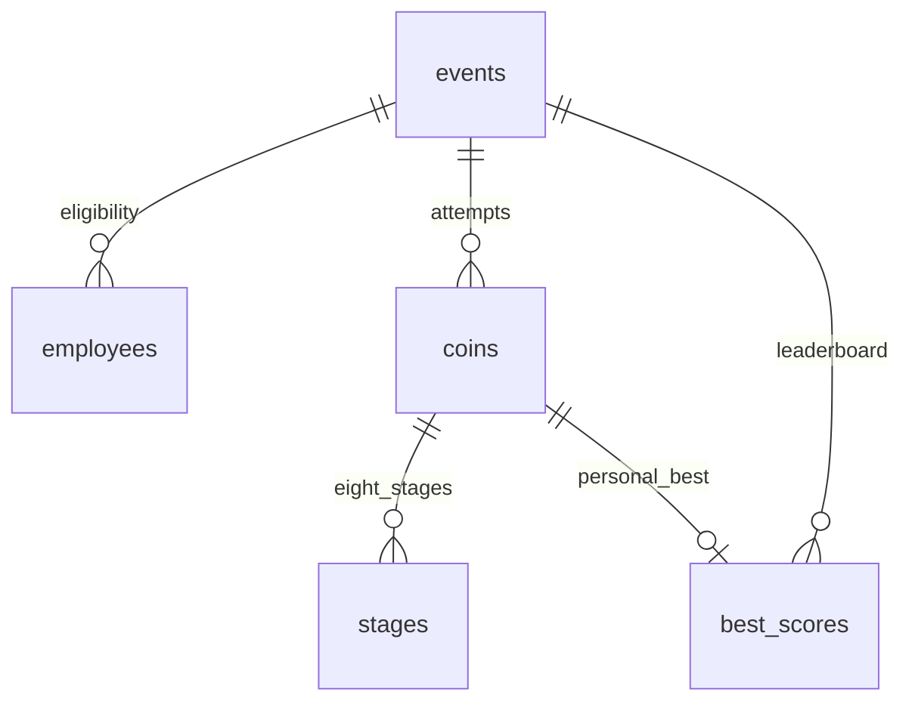

# 무궁무진 블랙홀

동아쏘시오그룹 조직문화 소통플랫폼 오픈 이벤트 게임입니다. 한 번의 도전은 8개 스테이지이며, 마지막 결과에서 사번을 입력해 최고 기록을 등록합니다.

## 실행

```sh
npm ci
npm test
npm run build
npm run dev
```

개발 주소는 `http://127.0.0.1:3000`입니다. Node.js 22 이상을 사용합니다. 환경변수는 실행 환경에 설정하거나 Node의 `--env-file=.env` 옵션으로 불러옵니다.

```sh
node --env-file=.env scripts/dev.cjs
```

`index.html`을 직접 열면 기존의 브라우저 저장 방식으로 미리 볼 수 있습니다. HTTP/HTTPS에서 실행하면 Vercel API와 Supabase를 사용합니다. 서버 설정이 없으면 연습 모드로 전환해 게임을 플레이할 수 있습니다. 연습 기록은 해당 브라우저에만 저장하며, 실제 이벤트의 전체 순위와 분리합니다. Supabase가 연결된 뒤 행사 기간이 닫혀 있는 경우에는 공식 접수를 계속 차단합니다.

## 점수와 순위

- 싱크로율 90% 이상이면 콤보가 1 증가하고, 미만이면 0이 됩니다.
- 콤보 보너스는 최대 콤보 기준으로 한 번 더합니다. 1콤보 100점부터 매번 두 배로 증가하며, 8콤보는 12,800점입니다.
- 퍼펙트 스테이지마다 500점을 추가합니다.
- 최종 점수는 `8단계 싱크로율 합계 × 10 + 최대 콤보 보너스 + 퍼펙트 횟수 × 500`입니다.
- 만점은 24,800점입니다.
- 사번별 최고 기록 하나만 순위에 반영합니다.
- 동점이면 싱크로율 합계가 높은 순서, 그 기록을 먼저 완료한 순서, 코인 ID 순서로 정렬합니다.
- 최고 점수와 같은 기록을 제출하면 더 높은 싱크로율 합계만 갱신합니다. 동일 점수·동일 합계라면 먼저 완료한 기록을 유지합니다.
- 이벤트 종료 시각부터 새 스테이지 기록과 사번 등록을 받지 않습니다. 종료 직전에는 마지막 사번 등록까지 마쳐야 합니다.

동점 규칙은 구현상 정한 초기값입니다. 행사 공지 전에 운영팀이 확정해야 합니다.

## 데이터 구조



모든 테이블은 API에서 직접 조회할 수 없는 `blackhole` 스키마에 있습니다.

| 테이블 | 저장 내용 |
| --- | --- |
| `events` | 행사 기간, 개방 여부, 사번 명부 사용 여부, 규칙 버전 |
| `employees` | 선택적으로 가져오는 참여 가능한 사번 명부 |
| `coins` | 도전 식별자, 세션 해시, 등록 사번, 최종 점수와 제출 시각 |
| `stages` | 단계별 시작 조건, 실제 제출 타이밍, 서버가 계산한 싱크로율 |
| `best_scores` | 행사·사번당 최고 기록 1개와 순위 계산용 값 |

현재 규칙으로 별도 이벤트를 생성하므로 기존 브라우저의 로컬 기록은 서버 순위에 가져오지 않습니다.

## Supabase 설정

1. 사용할 Supabase 프로젝트의 SQL Editor에서 `supabase/schema.sql` 전체를 실행합니다.
2. `supabase/operations.sql`의 행사 시작·종료 시각을 실제 일정으로 바꾼 뒤 활성화 쿼리를 실행합니다. 예시 날짜는 실행되지 않는 주석입니다. 초기 상태는 `draft`입니다.
3. 실제 사번 명부가 있으면 `blackhole.employees`에 가져오고 `require_employee_roster`를 켭니다.
4. Vercel 환경변수에 다음 값을 등록합니다.

| 환경변수 | 값 |
| --- | --- |
| `SUPABASE_URL` | 사용할 Supabase 프로젝트 URL |
| `SUPABASE_SERVICE_ROLE_KEY` | 서버 전용 service_role 또는 Supabase secret key |
| `EVENT_SLUG` | `mugung-mujin-2026` |
| `RATE_LIMIT_SECRET` | 32자 이상의 무작위 비밀값 |

비밀 키는 HTML, GitHub 파일, 채팅에 넣지 않습니다. `.env`와 `.vercel` 폴더는 Git에서 제외합니다.

서버 전용 비밀 키는 Vercel API에서만 사용합니다. 브라우저는 동일 출처 `/api/game`만 호출합니다. 데이터베이스 함수는 `anon`과 `authenticated` 권한을 제거하고 `service_role`만 호출할 수 있도록 설정했습니다.

## 서버 처리

1. 도전 시작 시 서버가 코인과 만료 시각을 발급합니다. 세션 원문은 HttpOnly 쿠키에, 해시는 DB에 저장합니다.
2. 서버가 각 스테이지의 초기 위상과 주기를 발급합니다.
3. 브라우저가 멈춘 타이밍을 보내면 DB가 중앙으로부터의 거리와 싱크로율·점수·콤보를 다시 계산합니다.
4. 8단계가 모두 저장된 코인만 마지막에 사번으로 등록할 수 있습니다.
5. 한 코인은 한 사번에만 등록할 수 있습니다. 응답이 유실되면 동일 요청을 다시 보내도 기존 기록을 반환합니다.
6. 동시 제출은 DB 행 잠금과 원자적 upsert로 처리합니다. 높은 최고점이 낮은 점수에 덮이지 않습니다.
7. 공개 TOP 100에는 마스킹한 사번만 반환합니다. 개인 순위는 해당 코인의 세션을 확인한 제출 요청에만 반환합니다.

서버 재계산은 클라이언트가 임의의 최종 점수를 제출하는 것을 막습니다. 브라우저 타이밍을 자동 생성하는 봇이나 타인 사번 입력까지 증명하지는 않습니다. 사번 명부는 존재 여부만 검사합니다. 상품 지급에 사용할 때에는 회사 로그인·본인확인 연결 또는 당첨자 확인 절차가 추가로 필요합니다. 관리자 검토에는 `stages` 원본 기록을 사용할 수 있습니다.

세션당 한 시간에 40코인, 같은 네트워크에서는 한 시간에 10,000코인까지 허용하도록 설정했습니다. 회사 공용 네트워크를 고려한 초기값입니다. 코인은 2시간 후 만료됩니다. 새로고침하면 진행 중인 코인은 이어서 플레이하지 않고 새로 시작합니다. 브라우저의 로컬 미리보기와 배포 순위는 별개입니다.

## GitHub와 Vercel

GitHub에는 루트의 소스와 `api`, `lib`, `scripts`, `supabase`, `tests`를 올립니다. `work`, 원본 ZIP, `.env`, `node_modules`, 빌드 산출물은 제외합니다.

Vercel에서 이 저장소를 가져오면 `vercel.json`이 다음 설정을 적용합니다.

- Framework preset은 Other입니다.
- Build command는 `npm run build`입니다.
- Output directory는 `public`입니다.
- `/api/game.js`는 서버 함수로 실행됩니다.
- 함수 지역은 서울 `icn1`입니다.

환경변수를 등록한 뒤 배포합니다. `/api/game?action=config`의 `configured`와 `accepting`이 모두 `true`이면 행사 기록을 받을 수 있습니다. 데이터베이스를 적용하기 전에는 `accepting`이 `true`가 될 수 없습니다.

`scripts/build.cjs`는 HTML에 포함된 이미지와 폰트를 해시 이름의 파일로 분리합니다. 중복 데이터가 제거되고 원본 HTML은 로컬에서 계속 열 수 있습니다.

## 행사 종료와 당첨자

행사가 종료되면 `operations.sql`의 조회 결과를 CSV로 내려받아 상위 100명의 전체 사번을 확인합니다. 공개 순위에는 전체 사번을 표시하지 않습니다. 행사 종료 후에는 `status='closed'`로 확정해 추가 기록을 막습니다. 관리자 화면은 이번 구현에 포함하지 않았으며, 운영 쿼리로 명단을 조회합니다.

## 검증 범위

`npm test`는 API 요청 검증, 브라우저의 8스테이지 진행과 저장 재시도, 실제 PostgreSQL 엔진(PGlite)의 점수 계산·중복 등록·최고 기록 보존·사번 마스킹·마감 처리를 검사합니다. 실제 Supabase와 Vercel 계정을 연결한 뒤에는 배포 환경에서도 한 코인 제출과 순위 조회를 확인해야 합니다. 6,000명 동시 접속 부하 시험은 수행하지 않았습니다.

글꼴과 이미지의 원래 제작자 안내는 게임 HTML 안에 유지합니다.

서버 함수와 권한 구성은 [Supabase 함수 문서](https://supabase.com/docs/guides/database/functions), 새 비밀 키 처리 방식은 [API 키 이전 안내](https://supabase.com/docs/guides/getting-started/migrating-to-new-api-keys), 배포 구성은 [Vercel Node.js 문서](https://vercel.com/docs/functions/runtimes/node-js)를 기준으로 작성했습니다.
